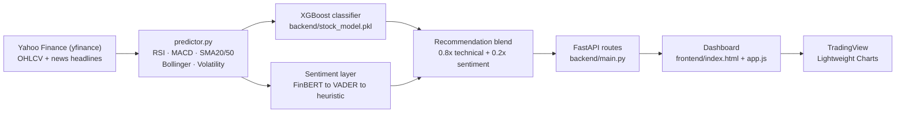

<div align="center">


<h1>Tape &amp; Trend</h1>
<p><strong>Indian Stock Market Dashboard · XGBoost Technical Signals · News Sentiment Blend</strong></p>

<p>
  
  
  
  
  
  
</p>

<p>
  <a href="#-installation--local-setup"><strong>Get Started</strong></a> ·
  <a href="#-api-reference"><strong>API Reference</strong></a> ·
  <a href="#-architecture--data-flow"><strong>Architecture</strong></a> ·
  <a href="#-disclaimer"><strong>Disclaimer</strong></a>
</p>

</div>

<br/>

> **What this is.** A FastAPI backend that pulls NSE (National Stock Exchange of India) price history from Yahoo Finance, engineers seven technical features, scores them with a trained XGBoost classifier, blends that with a news-sentiment signal, and serves the result to a glassmorphic single-page dashboard built with vanilla JS and TradingView's Lightweight Charts. Everything described below is verified against the source in this repository as of the latest commit — nothing here is aspirational.

<br/>

## 📊 Market Overview (Illustrative)


*The chart, volume bars, RSI line, index cards and signal thresholds above are a **static illustration** of what the live dashboard renders — not a snapshot of real market data. The actual numbers are computed at request time by `backend/predictor.py` from live Yahoo Finance data and are only available through a running instance of the API (`/api/history/{symbol}`, `/api/indices`, `/api/predict/{symbol}`).*

<br/>

## ✨ What's Actually Implemented

| Feature | Implementation | Status |
|---|---|---|
| **Live NSE price & volume data** | `yfinance` pulls OHLCV history per symbol in `predictor.fetch_price_history()` | ✅ Implemented |
| **Technical indicators** | RSI(14), MACD(12/26), SMA20, SMA50, Bollinger Bands(20,2), Return, Volatility — `predictor.calculate_indicators()` | ✅ Implemented |
| **XGBoost BUY/HOLD/SELL engine** | Pre-trained classifier `backend/stock_model.pkl` scored against 7 features from `backend/features.pkl` — `predictor.predict_stock()` | ✅ Implemented |
| **News sentiment scoring** | FinBERT (`ProsusAI/finbert` via `transformers`) attempted first, falls back to VADER, falls back to a keyword heuristic — `predictor.get_news_sentiment()` | ⚠️ Implemented, with caveats below |
| **Blended recommendation** | `final_score = 0.8 × technical_score + 0.2 × sentiment_score`, mapped to BUY (≥0.70) / HOLD / SELL (≤0.45) with target price, stop-loss and risk:reward — `predictor.get_recommendation()` | ✅ Implemented |
| **7-session forecast corridor** | A heuristic drift projection derived from `final_score`, not a separate forecasting model — `predictor.get_stock_history()` | ✅ Implemented (heuristic, not ML forecast) |
| **Interactive candlestick dashboard** | TradingView Lightweight Charts rendering candles, SMA, Bollinger Bands, RSI, MACD and the forecast corridor — `frontend/app.js` | ✅ Implemented |
| **NSE index tickers** | NIFTY 50, BANK NIFTY, NIFTY IT, NIFTY 100 with sparklines, no BSE/SENSEX — `predictor.get_market_indices()` | ✅ Implemented |
| **Portfolio analyzer** | `POST /api/portfolio` scores a list of symbols in one call | ✅ Implemented |
| **Bulk prediction grid** | `GET /api/predict-all` concurrently scores all 20 tracked stocks (`ThreadPoolExecutor`) | ✅ Implemented |
| **Light/dark glass UI** | Theme stored in `localStorage` (`bharat_market_theme`), toggled across charts and layout — `frontend/app.js`, `frontend/style.css` | ✅ Implemented |
| **In-memory TTL caching** | Predictions (180s), chart history (60s), indices (60s), bulk predictions (120s) | ✅ Implemented |
| **3D market globe / Three.js visualization** | Only a looping background **video** of a dot-matrix globe (`<video>` in `index.html`) — not an interactive Three.js/WebGL scene. No `docs/market-globe.html` exists in this repository. | ❌ Not implemented |

> A previous version of this README described an interactive Three.js 3D globe at `docs/market-globe.html`. That file does not exist in the repository at the time of writing — the only "globe" present is a decorative background video. This README removes that claim rather than carry it forward.

<br/>

## 🧠 Sentiment Engine — Read This Before Deploying

`predictor.get_news_sentiment()` tries three layers in order:

1. **FinBERT** (`transformers.pipeline("text-classification", model="ProsusAI/finbert")`) — only works if `transformers` and a compatible model download are available.
2. **VADER** (`vaderSentiment`) — listed in `backend/requirements.txt` but **absent from `backend/requirements-deploy.txt`**.
3. **Keyword heuristic fallback** — pure Python, always available.

Neither `transformers` nor `vaderSentiment` is installed in the Render deployment path (`requirements-deploy.txt`), so a production deploy following `render.yaml` as-is will silently fall back to the keyword heuristic (or neutral 0.5 if `yfinance` returns no headlines). Add the relevant package to `backend/requirements-deploy.txt` if you want FinBERT or VADER sentiment in production.

<br/>

## 🏗️ Architecture &amp; Data Flow



**Request path for a single stock:** `GET /api/predict/RELIANCE.NS` → `normalize_symbol()` appends `.NS` if missing → `fetch_price_history()` (1y daily bars) → `calculate_indicators()` → latest row's 7 features fed to the XGBoost model via `predict_proba()` → `get_news_sentiment()` runs alongside → both scores blended into `final_score` → mapped to BUY/HOLD/SELL with target price, stop-loss and risk:reward → cached in-memory for 180 seconds → returned as JSON.

<br/>

## 📁 Repository Structure

```text
stock_market/
├── backend/
│   ├── main.py                  # FastAPI app actually deployed (render.yaml entrypoint)
│   ├── predictor.py             # Indicators, XGBoost scoring, sentiment, caching
│   ├── stocks.py                # 20 tracked NSE symbols + 4 NSE indices
│   ├── app.py                   # Legacy/alternate FastAPI prototype (NewsAPI + VADER) — not wired into render.yaml or main.py
│   ├── stock_model.pkl          # Trained XGBoost model (binary)
│   ├── features.pkl             # Ordered feature list the model expects
│   ├── requirements.txt         # Local/dev dependencies (includes vaderSentiment)
│   ├── requirements-deploy.txt  # Render build dependencies (no vaderSentiment / transformers)
│   └── .env.example             # NEWSAPI_KEY, CACHE_TTL_SECONDS (used by the legacy app.py only)
├── frontend/
│   ├── index.html               # Dashboard markup (separate from root index.html)
│   ├── app.js                   # Chart rendering, API calls, theming, modal, ticker
│   ├── config.js                # window.API_BASE resolution (localhost:8000 vs same-origin)
│   ├── style.css                # Glassmorphism dual-theme design system
│   └── lightweight-charts.standalone.js  # Vendored TradingView Lightweight Charts build
├── docs/
│   └── assets/                  # SVG assets added for this README (hero-market.svg, market-chart.svg)
├── index.html                   # Root landing page served by Vercel, links to frontend/ assets
├── render.yaml                  # Render deployment config (backend API)
├── vercel.json                  # Vercel deployment config (static frontend)
└── README.md
```

<br/>

## ⚙️ Installation &amp; Local Setup

### Prerequisites

- Python 3.10 or newer
- `pip`
- A modern browser (Chrome, Edge, Firefox, Safari)

### 1. Clone the repository

```bash
git clone https://github.com/asuwathkumaresh07-cyber/stock_market.git
cd stock_market
```

### 2. Create a virtual environment

**Windows (PowerShell):**
```powershell
python -m venv .venv
.\.venv\Scripts\Activate.ps1
```

**Linux / macOS:**
```bash
python3 -m venv .venv
source .venv/bin/activate
```

### 3. Install backend dependencies

```bash
python -m pip install --upgrade pip
pip install -r backend/requirements.txt
```

Use `backend/requirements-deploy.txt` instead if you want to mirror the Render build environment exactly (note: this set excludes `vaderSentiment` — see the sentiment caveat above).

### 4. Start the backend (FastAPI + Uvicorn)

From the repository root — this is the import path `render.yaml` uses in production:

```bash
uvicorn backend.main:app --reload --host 127.0.0.1 --port 8000
```

`backend/main.py` mounts `frontend/` as static files at `/`, so visiting `http://127.0.0.1:8000` directly serves the dashboard from the same origin as the API — no separate frontend server is required.

- API root: `http://127.0.0.1:8000`
- Interactive API docs (Swagger UI): `http://127.0.0.1:8000/docs`
- Health check: `http://127.0.0.1:8000/api/health`

### 5. (Optional) Run the frontend as a separate static server

If you'd rather serve the frontend independently of the API (matching `frontend/config.js`, which targets `http://localhost:8000` when the page is served from port `5500`):

```bash
python -m http.server 5500 --directory frontend
```

Then open `http://127.0.0.1:5500`. Keep the backend from step 4 running — the backend's CORS middleware currently allows all origins (`*`), so no extra configuration is needed locally.

### 6. Environment variables

`backend/.env.example` is consumed only by the **legacy** `backend/app.py` prototype, not by `backend/main.py`:

```env
# Get a free key at https://newsapi.org (Developer plan works on localhost)
NEWSAPI_KEY=your_newsapi_key_here

# Optional: how long (seconds) each cached result stays fresh
CACHE_TTL_SECONDS=300
```

The production entrypoint (`backend/main.py` → `predictor.py`) requires **no environment variables** — it uses `yfinance` directly for both price data and news headlines (`ticker.news`).

<br/>

## 🚀 Deployment

The repository ships with configuration for two platforms:

**Backend — Render (`render.yaml`)**
```yaml
buildCommand: pip install -r backend/requirements-deploy.txt
startCommand: uvicorn backend.main:app --host 0.0.0.0 --port $PORT
healthCheckPath: /api/health
```

**Frontend — Vercel (`vercel.json`)**
```json
{
  "outputDirectory": "frontend",
  "framework": null,
  "buildCommand": null,
  "installCommand": null
}
```

No live deployment URL is published inside this repository, so none is linked here. Before deploying:

1. Confirm `backend/requirements-deploy.txt` includes whatever your target sentiment layer needs (see the sentiment caveat above).
2. If the frontend is deployed separately from the backend (e.g., Vercel for `frontend/`, Render for `backend/`), update `frontend/config.js` to point at the deployed API origin instead of `localhost:8000`.
3. Tighten CORS in `backend/main.py` (currently `allow_origins=["*"]`) to your actual frontend origin before going to production.
4. Confirm `backend/stock_model.pkl` and `backend/features.pkl` are included in the deployment artifact — they're loaded at import time, and the app fails to start without them.

<br/>

## 🔌 API Reference

All routes below are read directly from `backend/main.py`. `GET /predict/{symbol}` and `GET /api/predict/{symbol}` are intentionally duplicated in the source (same handler, two paths), as are `POST /portfolio` and `POST /api/portfolio`.

| Method | Route | Purpose |
|---|---|---|
| `GET` | `/api/health` | Service status and API version |
| `GET` | `/api/indices` | NIFTY 50, BANK NIFTY, NIFTY IT, NIFTY 100 snapshot + sparkline |
| `GET` | `/api/history/{symbol}?period=&interval=` | Full OHLCV candles, volume, SMA20/50, Bollinger Bands, RSI, MACD, 7-session forecast corridor |
| `GET` | `/api/predict/{symbol}` (also `/predict/{symbol}`) | BUY/HOLD/SELL recommendation for one symbol |
| `GET` | `/api/stocks` | The 20 tracked NSE symbols + 4 indices |
| `GET` | `/api/news/{symbol}` | Per-headline sentiment used by the dashboard's news modal |
| `GET` | `/api/predict-all` | Recommendation for all 20 tracked stocks, run concurrently |
| `POST` | `/api/portfolio` (also `/portfolio`) | Body `{"symbols": ["RELIANCE.NS", "TCS.NS"]}` → recommendation per symbol |

**Example — illustrative response shape** for `GET /api/predict/RELIANCE.NS` (field names match `predictor.get_recommendation()`; actual values depend on live market data at request time):

```json
{
  "stock": "RELIANCE.NS",
  "company": "Reliance Industries",
  "price": 2456.30,
  "day_change_pct": 1.12,
  "rsi": 58.4,
  "technical_score": 0.71,
  "sentiment_score": 0.62,
  "sentiment_label": "Positive",
  "final_score": 0.6824,
  "recommendation": "HOLD",
  "confidence": 68,
  "target_price": 2500.65,
  "stop_loss": 2370.33,
  "expected_roi": "+1.8% Range",
  "signal_strength": "Neutral Hold",
  "risk_reward": "1 : 1.2",
  "explanation": [
    "RSI (58.4) indicates solid bullish momentum",
    "MACD is positive in bullish territory",
    "Current price (₹2456.30) trading above 20-day SMA (₹2410.12)",
    "20-day SMA above 50-day SMA (sustained uptrend)"
  ],
  "as_of": "2026-10-17"
}
```

Open `http://127.0.0.1:8000/docs` for the live, authoritative Swagger UI generated from the actual FastAPI route definitions.

<br/>

## 📈 Tracked Universe

20 NSE large-caps (all `.NS` suffixed — no BSE symbols), defined in `backend/stocks.py`:

<details>
<summary><strong>Show all 20 tracked stocks + 4 indices</strong></summary>

| Symbol | Company |
|---|---|
| RELIANCE.NS | Reliance Industries |
| TCS.NS | Tata Consultancy Services |
| HDFCBANK.NS | HDFC Bank |
| ICICIBANK.NS | ICICI Bank |
| INFY.NS | Infosys |
| HINDUNILVR.NS | Hindustan Unilever |
| ITC.NS | ITC Limited |
| SBIN.NS | State Bank of India |
| BHARTIARTL.NS | Bharti Airtel |
| KOTAKBANK.NS | Kotak Mahindra Bank |
| LT.NS | Larsen &amp; Toubro |
| AXISBANK.NS | Axis Bank |
| BAJFINANCE.NS | Bajaj Finance |
| MARUTI.NS | Maruti Suzuki |
| SUNPHARMA.NS | Sun Pharmaceutical |
| TITAN.NS | Titan Company |
| ASIANPAINT.NS | Asian Paints |
| WIPRO.NS | Wipro |
| ADANIENT.NS | Adani Enterprises |
| TATAMOTORS.NS | Tata Motors |

Indices: `^NSEI` (NIFTY 50), `^NSEBANK` (BANK NIFTY), `^CNXIT` (NIFTY IT), `^CNX100` (NIFTY 100) — pure NSE only, no SENSEX/BSE.

</details>

<br/>

## 🧪 Model Notes &amp; Limitations

- The model is a **pre-trained, static** XGBoost classifier shipped as a binary (`backend/stock_model.pkl`); this repository does not include training code, a training dataset, or evaluation metrics (accuracy, precision/recall, backtest results). No performance numbers are claimed here because none are verifiable from the repository contents.
- The 7-session "forecast" line is **not** a second model — it's a deterministic drift projection computed from `final_score` with a widening uncertainty band (`predictor.get_stock_history()`), meant as a visual corridor, not a prediction with its own accuracy guarantee.
- Indicators are computed from whatever history `yfinance` returns at request time; thin trading days, exchange holidays, or Yahoo Finance outages will change indicator values and, in turn, predictions.
- `GET /api/predict/{symbol}` and `/api/history/{symbol}` surface the same underlying recommendation but go through slightly different code paths with independent in-memory caches, so brief inconsistencies between the two endpoints are possible within a cache window.

<br/>

## 🔐 Security Considerations

- CORS middleware currently uses `allow_origins=["*"]` — fine for local development, not recommended as-is in production.
- No authentication is implemented on any endpoint; all routes are public.
- `backend/.env.example` shows the shape of a `NEWSAPI_KEY` variable for the legacy `app.py`; never commit a real `.env` file (`backend/.env` is already excluded via `.gitignore`).
- `backend/stock_model.pkl` is loaded with `pickle.load()` at import time — only use model files from a source you trust, since unpickling arbitrary data can execute code.

<br/>

## 🗺️ Roadmap

Realistic next steps based on current gaps in the codebase, not fabricated commitments:

- [ ] Add training code, dataset provenance, and evaluation metrics for `stock_model.pkl`
- [ ] Add `transformers` / `vaderSentiment` to `requirements-deploy.txt` (or explicitly document the fallback) so production sentiment behavior matches local behavior
- [ ] Add automated tests and CI
- [ ] Add authentication/rate-limiting before any public production deployment
- [ ] Persist caches (e.g., Redis) instead of in-memory dicts for multi-worker deployments
- [ ] Replace the decorative background video with (or add) a genuine interactive market visualization, if one is wanted

<br/>

## 🤝 Contributing

1. Fork the repository
2. Create a feature branch: `git checkout -b feature/your-feature`
3. Make your changes and test locally against `uvicorn backend.main:app --reload`
4. Commit with a descriptive message
5. Open a pull request

<br/>

## 📄 License

No `LICENSE` file is currently present in this repository. Until one is added, default copyright applies and no reuse rights are implied — contact the repository owner before reusing this code.

<br/>

## ⚠️ Disclaimer

This project is an educational and research tool. Recommendations are generated by combining a statistical XGBoost classifier with a news-sentiment signal; they are **not** financial advice and carry no guarantee of accuracy. Past model behavior does not predict future returns. Markets carry real risk — always do independent research before making investment decisions.

**Data source & freshness:** all price, volume and news data is fetched live from Yahoo Finance via `yfinance` at request time (cached in-memory for 60–180 seconds depending on endpoint). Yahoo Finance is an unofficial, rate-limited data source with no uptime guarantee; outages or schema changes upstream can break endpoints without notice.

<br/>

<div align="center">

**[asuwathkumaresh07-cyber/stock_market](https://github.com/asuwathkumaresh07-cyber/stock_market)** · [API Docs (local)](http://127.0.0.1:8000/docs) · [Issues](https://github.com/asuwathkumaresh07-cyber/stock_market/issues)

Built for exploring stock-market analytics, applied machine learning, and modern web dashboards.

</div>
